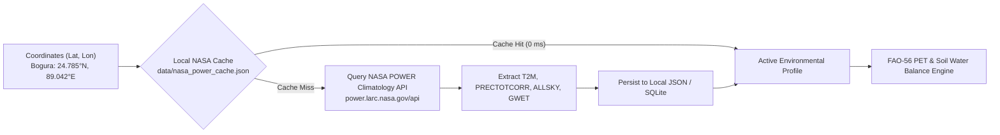
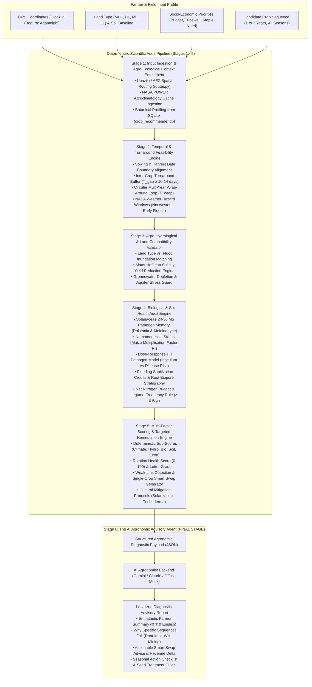

# NASA-Powered Climate-Resilient Crop Rotation Decision Support System (DSS)
## Architecture & Scientific Specification for "Field Shift: Adapting Farms with NASA Data"

> **Executive Scope & Mission Alignment:** This document establishes the complete architectural, mathematical, and data engineering specification for the **Crop Sequence Evaluator & Diagnostic Advisory Decision Support System (DSS)**.
> 
> Engineered specifically for the **NASA International Space Apps Challenge ("Field Shift: Adapting Farms with NASA Data")**, the system integrates **NASA Earth Observations (NASA POWER agroclimatology, MERRA-2 assimilation, CERES solar radiation, and SMAP soil moisture)** with **local soil biogeochemistry (SOC, NPK balance, pH, Maas-Hoffman salinity)** and **smallholder socio-economic constraints (budget BDT, water pumping costs, land holding size, staple food security)** to:
> 1. **Audit & Diagnose Farmer Sequences:** Evaluates any farmer-submitted 1-to-3 year crop sequence through an objective 5-stage deterministic biophysical audit pipeline.
> 2. **Quantify Climate-Soil-Pest Risks:** Delivers mathematically transparent diagnostic sub-scores (0–100) for climate hazard exposure, turnaround friction, soil nutrient/carbon mining, and soilborne disease cycles.
> 3. **Recommend Targeted Single-Crop Remediation ("Smart Swaps"):** Isolates the agronomic weak link in a rotation and identifies optimal replacement crops or cultural mitigations.
> 4. **Explainable AI in the Final Stage (Stage 6):** Synthesizes verified deterministic diagnostic facts into empathetic, actionable, and culturally grounded extension advice in **Bengali (বাংলা) and English** with zero hallucinations.
>
> **Prototype Testbed:** **Bogura District, Bangladesh** (Adamdighi and Shibganj Upazilas, AEZ 3 & 25) — Bangladesh's intensive commercial vegetable, seed, and cereal production hub, with contrast testbeds in Coastal Saline (Satkhira), Drought-Prone High Barind (Rajshahi), and Haor Wetland (Sunamganj).
>
> **System Decoupling Boundary:** Combinatorial generation of Top-3 rotation archetypes from scratch is executed by the core Recommender Pipeline. This Evaluator feature exclusively audits, scores, diagnoses, and remediates farmer-submitted crop sequences.

---

## 0. Evaluator Input Specification & Complete Data Contracts

The Crop Sequence Evaluator ingests a multi-dimensional smallholder farm profile across four distinct operational domains: **Geographic Location**, **Soil & Field Biophysics**, **Farmer Socio-Economic Priorities**, and the **Evaluated Crop Sequence**.

### 0.1 Input Parameter Matrix

| Domain | Parameter Name | CLI Flag | Required? | Type & Constraints | Default | Agronomic & Biophysical Function in DSS |
| :--- | :--- | :--- | :---: | :--- | :---: | :--- |
| **Location** | `lat` | `--lat` | **YES** | `float` ($-90.0$ to $90.0$) | *None* | Geographic latitude; indexes NASA POWER $0.5^\circ$ grid & solar geometry $R_a$. |
| | `lon` | `--lon` | **YES** | `float` ($-180.0$ to $180.0$) | *None* | Geographic longitude; indexes NASA POWER climate normals & Upazila boundary ray-casting. |
| | `upazila` | `--upazila` | Optional | `string` | `None` | Upazila administrative boundary (e.g. `Adamdighi`, `Shyamnagar`, `Godagari`). Auto-resolved via Jordan Curve PIP if omitted. |
| | `district` | `--district` | Optional | `string` | `None` | District administrative name (e.g. `Bogura`, `Satkhira`, `Rajshahi`). |
| | `division` | *(JSON/API)* | Optional | `string` | `None` | Administrative division (e.g. `Rajshahi`, `Khulna`, `Sylhet`). |
| | `aez` | *(JSON/API)* | Optional | `int` ($1$ to $30$) | `None` | Official Agro-Ecological Zone (AEZ) index for regional calendar alignment. |
| **Field & Soil** | `land_type` | `--land-type` | **YES** | `str`: `HL`, `MHL`, `MLL`, `LL`, `VLL` | `"MHL"` | Land inundation depth class. Determines monsoonal flood risk, Boro vs T. Aman feasibility, and turnaround penalty mechanics. |
| | `soil_salinity_ec_e` | `--salinity` | Optional | `float` ($\ge 0.0$ dS/m) | `0.80` | Topsoil saturated extract electrical conductivity ($EC_e$). Drives Maas-Hoffman piecewise linear salt yield response $Y_{\text{rel}} = \max(0, 100 - b(EC_e - a))$. |
| | `soil_ph` | `--ph` | Optional | `float` ($3.0$ to $10.0$) | `6.20` | Soil reaction index. Detects aluminum/iron toxicity in acid soils ($\text{pH} < 5.5$) or micronutrient zinc/phosphorus fixation in alkaline soils ($\text{pH} > 8.0$). |
| | `soil_texture` | *(JSON/API)* | Optional | `string` | `"Silt Loam"` | USDA texture classification. Sets maximum soil water holding capacity ($S_{\max}$) in two-step tipping bucket. |
| | `soil_organic_carbon_pct`| *(JSON/API)* | Optional | `float` ($\ge 0.0\%$) | `1.10%` | Baseline topsoil ($0\text{--}20\text{ cm}$) organic carbon percentage. Drives Hénin-Dupuis duration-weighted annual $\Delta\text{SOC}$ oxidation balance. |
| | `drainage_condition` | *(JSON/API)* | Optional | `str`: `poor`, `moderate`, `good`| `"moderate"`| Soil drainage class influencing waterlogging risk and root aeration. |
| | `bulk_density` | *(JSON/API)* | Optional | `float` ($\text{g/cm}^3$) | `1.50` | Soil dry bulk density ($\rho_b$) used to convert volumetric soil organic carbon and water depth. |
| **Socio-Economics** | `total_budget_bdt` | `--budget` | Optional | `float` ($\ge 0.0$ BDT) | `120000.0` | Farmer's annual working capital budget. Evaluates whether production cost creates mid-season input cash traps. |
| | `land_size_ha` | `--area` | Optional | `float` ($> 0.0$ ha) | `0.40` | Total operational landholding area in hectares ($0.40\text{ ha} \approx 1\text{ acre}$). Scales total input costs and grain outputs. |
| | `irrigation_source` | `--irrigation` | Optional | `str`: `shallow_tubewell`, `deep_tubewell`, `surface_canal`, `rainfed` | `"shallow_tubewell"` | Primary irrigation infrastructure. Evaluates dry-season irrigation cost and groundwater drawdown risk. |
| | `water_cost_per_m3_bdt`| *(JSON/API)*| Optional | `float` (BDT/m³) | `3.50` | Unit volumetric tariff or diesel pumping cost per cubic meter of applied water. |
| | `food_security_staple_needed`| *(JSON/API)*| Optional | `bool` | `True` | Whether the household requires at least one primary staple cereal crop (rice/wheat) for subsistence. |
| | `risk_tolerance` | *(JSON/API)*| Optional | `str`: `conservative`, `moderate`, `aggressive` | `"moderate"` | Smallholder risk profile governing severity thresholds for crop swapping. |
| **Crop Sequence** | `crop_name` | `--sequence` | **YES** | `string` | *None* | Botanical common name of the crop (e.g. `Potato`, `Tomato`, `T. Aman Rice`, `Boro Rice`, `Mustard`, `Mungbean`, `Sunflower`). |
| | `season` | `--sequence` | **YES** | `str`: `Rabi`, `Kharif-1`, `Kharif-2`, `Fallow` | *Inferred* | Agronomic growing season in Bangladesh's 3-season cycle. |
| | `year` | `--sequence` | **YES** | `int` ($\ge 1$) | `1` | Rotation year sequence (Year 1, Year 2, Year 3). |
| | `cultivar` | *(JSON/API)* | Optional | `string` | `None` | Specific released cultivar (e.g. `BRRI dhan88`, `BARI Mung-6`). Overrides generic phenological duration (e.g. 140d early vs 160d late Boro). |
| | `sowing_date_approx` | *(JSON/API)* | Optional | `string` (`YYYY-MM-DD`) | `None` | Exact calendar sowing/transplanting date for precision phenological overlay. |
| | `stover_management` | *(JSON/API)* | Optional | `str`: `incorporated`, `removed`, `grazed` | `"incorporated"` | Residue management method. Determines legume Biological Nitrogen Fixation residual credit ($NHI=0.70$) and carbon input credit. |

---

### 0.2 Complete Real-World Multi-Input Working Example

Here is a full real-world scenario where **all inputs across all four domains are explicitly populated**:

#### 1. Command-Line Interface (CLI Execution with All Flags)
```bash
python3 src/evaluate_sequence_cli.py \
  --lat 24.7850 \
  --lon 89.0420 \
  --upazila "Adamdighi" \
  --district "Bogura" \
  --sequence "Rabi:Potato;Kharif-1:Tomato;Kharif-2:T. Aman Rice" \
  --land-type "MHL" \
  --salinity 0.80 \
  --ph 6.2 \
  --budget 120000.0 \
  --area 0.40 \
  --irrigation "shallow_tubewell" \
  --json
```

#### 2. Fully Populated JSON Input Contract (`data/farmer_profile_example.json`)
```json
{
  "location": {
    "lat": 24.7850,
    "lon": 89.0420,
    "upazila": "Adamdighi",
    "district": "Bogura",
    "division": "Rajshahi",
    "aez": 3
  },
  "field_conditions": {
    "land_type": "MHL",
    "soil_texture": "Silt Loam",
    "soil_ph": 6.2,
    "soil_organic_carbon_pct": 1.10,
    "soil_salinity_ec_e": 0.80,
    "drainage_condition": "moderate",
    "bulk_density": 1.50
  },
  "farmer_priorities": {
    "land_size_ha": 0.40,
    "total_budget_bdt": 120000.0,
    "irrigation_source": "shallow_tubewell",
    "water_cost_per_m3_bdt": 3.5,
    "food_security_staple_needed": true,
    "risk_tolerance": "moderate"
  },
  "target_horizon_years": 1,
  "farmer_evaluated_sequence": [
    {
      "year": 1,
      "season": "Rabi",
      "crop_name": "Potato",
      "cultivar": "Diamond (HYV)",
      "sowing_date_approx": "2024-11-15",
      "stover_management": "removed"
    },
    {
      "year": 1,
      "season": "Kharif-1",
      "crop_name": "Tomato",
      "cultivar": "Summer Hybrid",
      "sowing_date_approx": "2025-03-01",
      "stover_management": "incorporated"
    },
    {
      "year": 1,
      "season": "Kharif-2",
      "crop_name": "T. Aman Rice",
      "cultivar": "BRRI dhan49",
      "sowing_date_approx": "2025-07-20",
      "stover_management": "incorporated"
    }
  ],
  "preferences": {
    "language": "bn",
    "tone": "farmer_friendly"
  }
}
```

#### 3. Programmatic Python Execution (Complete Dataclass Model)
```python
from src.evaluator import (
    EvaluatorEngine,
    FarmerProfile,
    LocationInput,
    FieldConditions,
    FarmerPriorities,
    CropInput
)

# Initialize engine
engine = EvaluatorEngine()

# Populate all input objects explicitly
profile = FarmerProfile(
    location=LocationInput(
        lat=24.7850,
        lon=89.0420,
        upazila="Adamdighi",
        district="Bogura",
        division="Rajshahi",
        aez=3
    ),
    field_conditions=FieldConditions(
        land_type="MHL",
        soil_texture="Silt Loam",
        soil_ph=6.2,
        soil_organic_carbon_pct=1.10,
        soil_salinity_ec_e=0.80,
        drainage_condition="moderate",
        bulk_density=1.50
    ),
    farmer_priorities=FarmerPriorities(
        land_size_ha=0.40,
        total_budget_bdt=120000.0,
        irrigation_source="shallow_tubewell",
        water_cost_per_m3_bdt=3.5,
        food_security_staple_needed=True,
        risk_tolerance="moderate"
    ),
    target_horizon_years=1,
    farmer_evaluated_sequence=[
        CropInput(year=1, season="Rabi", crop_name="Potato", cultivar="Diamond (HYV)", sowing_date_approx="2024-11-15", stover_management="removed"),
        CropInput(year=1, season="Kharif-1", crop_name="Tomato", cultivar="Summer Hybrid", sowing_date_approx="2025-03-01", stover_management="incorporated"),
        CropInput(year=1, season="Kharif-2", crop_name="T. Aman Rice", cultivar="BRRI dhan49", sowing_date_approx="2025-07-20", stover_management="incorporated")
    ],
    preferences={"language": "bn", "tone": "farmer_friendly"}
)

# Run evaluation
audit_result = engine.evaluate(profile)
```

---

## 1. NASA Earth Observations Integration in Practice

Rather than treating NASA datasets as static references, the engine actively embeds daily and monthly NASA Earth Observation products (Stackhouse et al., 2021) directly into its mathematical water balance, thermal regime, and pest forecasting algorithms.

### 1.1 NASA Data Products, Missions & Agronomic Variables

| Parameter Name | Mission / Assimilation Source | Resolution | Practical Agronomic Function in DSS | Official Source Link |
| :--- | :--- | :--- | :--- | :--- |
| **`PRECTOTCORR`** | NASA POWER / MERRA-2 & GPM | Daily, $0.5^\circ \times 0.5^\circ$ | Precipitation corrected for gauge bias; computes daily soil water deficit ($P - ET_0$), monsoon onset, and harvest rot hazard windows. | [NASA POWER Portal](https://power.larc.nasa.gov/) |
| **`ALLSKY_SFC_SW_DWN`** | NASA POWER / CERES Satellite | Daily ($MJ/m^2/day$) | All-sky surface downward solar irradiance; drives FAO-56 Penman-Monteith / Hargreaves-Samani reference evapotranspiration ($ET_0$) and biomass potential. | [NASA CERES Project](https://ceres.larc.nasa.gov/) |
| **`T2M`, `T2M_MAX`, `T2M_MIN`** | NASA POWER / MERRA-2 Reanalysis | Daily Temperature ($^\circ\text{C}$) | Calculates Growing Degree Days (GDD), thermal suitability windows, and extreme heat sterility / cold injury thresholds during flowering. | [NASA MERRA-2](https://gmao.gsfc.nasa.gov/reanalysis/MERRA-2/) |
| **`GWETTOP`** | NASA POWER / MERRA-2 Land / SMAP | Daily (0.0 to 1.0) | Topsoil moisture (0–5 cm layer) for seed germination feasibility and post-rice tillage tilth tracking. | [NASA SMAP Mission](https://smap.jpl.nasa.gov/) |
| **`GWETROOT`** | NASA POWER / MERRA-2 Land / SMAP | Daily (0.0 to 1.0) | Root-zone wetness (0–100 cm depth) tracking drought stress depletion for rainfed upland crops. | [NASA SMAP Mission](https://smap.jpl.nasa.gov/) |
| **`RH2M` & `T2MDEW`** | NASA POWER / Modern Sounders | Daily (%) & Dew Point ($^\circ\text{C}$) | Vapor pressure deficit (VPD) and leaf wetness hours; models late blight (*Phytophthora infestans*) disease outbreaks in potato. | [NASA POWER API Docs](https://power.larc.nasa.gov/docs/services/api/temporal/climatology/) |

### 1.2 NASA Data Fetching & Offline Caching Architecture

To guarantee high reliability in rural extension kiosks with intermittent connectivity, the engine uses standard library `urllib.request` with an offline JSON write-through cache:



#### NASA POWER API Query Specification:
- **Base Endpoint:** `https://power.larc.nasa.gov/api/temporal/climatology/point`
- **Query Parameters:** `community=AG&parameters=T2M,T2M_MAX,T2M_MIN,PRECTOTCORR,ALLSKY_SFC_SW_DWN,GWETTOP,GWETROOT,RH2M&longitude=89.0420&latitude=24.7850&format=JSON`
- **Output Schema:** JSON dictionary indexed by parameter and month (1 to 12).

### 1.3 Mathematical Formulations: Daily Evapotranspiration ($ET_0$) & Soil Water Balance

Reference crop evapotranspiration ($ET_0$) is computed using the **FAO-56 Hargreaves-Samani equation** (Allen et al., 1998; Hargreaves & Samani, 1985):

$$ET_0 = 0.0023 \cdot \left(T_{\text{mean}} + 17.8\right) \cdot \sqrt{T_{\text{max}} - T_{\text{min}}} \cdot R_a$$

Where:
- $T_{\text{mean}}, T_{\text{max}}, T_{\text{min}}$: Daily mean, maximum, and minimum 2-meter air temperatures ($^\circ\text{C}$) from NASA POWER MERRA-2.
- $R_a$: Extraterrestrial solar radiation expressed in equivalent water evaporation ($\text{mm/day}$), calculated as a function of latitude $\phi$ and solar declination $\delta$ (FAO-56 eq. 21):
  $$R_a = \frac{24 \times 60}{\pi} G_{sc} d_r \left[ \omega_s \sin(\phi) \sin(\delta) + \cos(\phi) \cos(\delta) \sin(\omega_s) \right] \times 0.408$$
  where $G_{sc} = 0.0820\text{ MJ/m}^2/\text{min}$, $d_r$ is relative inverse distance Earth-Sun, and $\omega_s$ is sunset hour angle.

#### Daily Soil Water Balance Tipping-Bucket Model:
Soil moisture storage in the crop root zone is audited across the sequence using a sequential two-step tipping-bucket model (Allen et al., 1998; Ritchie, 1972):

$$W_{\text{pot}} = W_{t-1} + P_{\text{daily}} + I_{\text{daily}} - ET_c$$
$$D_{\text{deep}} = \max\left(0.0, W_{\text{pot}} - S_{\max}\right)$$
$$W_t = \max\left(0.0, \min\left(S_{\max}, W_{\text{pot}} - D_{\text{deep}}\right)\right)$$

Where:
- $S_{\max} = 1000 \cdot (\theta_{FC} - \theta_{WP}) \cdot Z_r$: Available Water Capacity ($\text{mm}$), typically $100\text{--}140\text{ mm}$ for Bogura silt loam ($Z_r = 0.8\text{ m}$).
- $P_{\text{daily}}$: Corrected precipitation (`PRECTOTCORR`) from NASA POWER ($\text{mm/day}$).
- $I_{\text{daily}}$: Farmer irrigation input ($\text{mm/day}$).
- $ET_c = K_c \cdot ET_0$: Crop evapotranspiration with seasonal crop coefficient $K_c$.
- $D_{\text{deep}}$: Deep drainage percolation loss beyond the root zone when potential water $W_{\text{pot}} > S_{\max}$.

### 1.4 Step-by-Step Numerical Example: Bogura Peak Rabi Drought Stress
- **Location:** Adamdighi Upazila, Bogura ($24.785^\circ\text{N}, 89.042^\circ\text{E}$), Day of Year = 105 (April 15, late Rabi / early Kharif-1).
- **NASA Inputs:**
  - $T_{\text{max}} = 35.8^\circ\text{C}$, $T_{\text{min}} = 21.4^\circ\text{C}$, $T_{\text{mean}} = 28.6^\circ\text{C}$.
  - Temperature difference: $\Delta T = 35.8 - 21.4 = 14.4^\circ\text{C}$; $\sqrt{\Delta T} = 3.795$.
  - Extraterrestrial radiation: $R_a = 37.1\text{ MJ/m}^2/\text{day} \times 0.408 = 15.14\text{ mm/day}$.
  - NASA `PRECTOTCORR` = $0.0\text{ mm/day}$.
- **Hargreaves Calculation:**
  $$ET_0 = 0.0023 \cdot (28.6 + 17.8) \cdot 3.795 \cdot 15.14 = 0.0023 \cdot 46.4 \cdot 3.795 \cdot 15.14 = 6.13\text{ mm/day}$$
- **Agronomic Comparison (Maize vs. Mungbean):**
  - **Hybrid Maize (late grain filling, $K_c = 1.15$):** $ET_c = 1.15 \times 6.13 = 7.05\text{ mm/day}$. Over a 10-day rainless spell, water deficit = $70.5\text{ mm}$. If rainfed ($I_{\text{daily}} = 0$), root-zone storage ($W_t$) drops from $60\text{ mm}$ to $0\text{ mm}$ in 8.5 days, triggering a severe terminal drought yield penalty ($-40\%$).
  - **Mungbean (BARI Mung-6, vegetative, $K_c = 0.65$):** $ET_c = 0.65 \times 6.13 = 3.98\text{ mm/day}$. Over 10 days, deficit is only $39.8\text{ mm}$, remaining well within available soil moisture reserve ($W_t > \text{RAW}$).

---

## 2. Quantitative Soil Health Dynamics & Biogeochemistry

The DSS models soil health through four quantitative chemical and physical equations rather than qualitative proxies.

### 2.1 Soil Organic Carbon (SOC) Trajectory Model
Continuous intensive rototillage, tuber harvesting, and complete crop residue removal rapidly oxidize organic matter in subtropical Bangladesh. The annual change in soil organic carbon ($\Delta \text{SOC}_{\text{annual}}$, $\text{t C/ha/year}$) is calculated using a duration-weighted, single-pool first-order decay equation based on the Hénin-Dupuis framework and ICBM (Hénin & Dupuis, 1945; Lal, 2004):

$$\Delta \text{SOC}_{\text{annual}} = \sum_{i=1}^K \left( C_{\text{input}, i} \cdot \alpha_{\text{hum}, i} \right) - \text{SOC}_{\text{baseline}} \cdot k_{\text{decomp}} \sum_{i=1}^K \left( \frac{\text{Days}_i}{365} \cdot F_{\text{redox}, i} \cdot F_{\text{till}, i} \right)$$

Where:
- $C_{\text{input}, i}$: Above-ground and root biomass carbon returned to soil by crop $i$ ($\text{t C/ha}$).
  - Dedicated green manure (*Sesbania aculeata* / Dhaincha): $+2.0\text{ t C/ha}$.
  - Grain legume with stover incorporation (Mungbean): $+0.85\text{ t C/ha}$.
  - Cereal with stubble retention ($20\text{ cm}$ rice stubble): $+0.40\text{ t C/ha}$.
  - Tuber crops with intensive soil harvesting (Potato): $-0.15\text{ t C/ha}$ (net export).
- $\alpha_{\text{hum}, i}$: Humification coefficient converting raw biomass carbon into stable humus ($0.12$ for succulent green manure, $0.22$ for lignified stover; Lal, 2004).
- $\text{SOC}_{\text{baseline}}$: Baseline organic carbon pool in top $20\text{ cm}$ soil depth. In Bogura ($\text{SOC} = 1.1\%$, bulk density $\rho_b = 1.50\text{ g/cm}^3$):
  $$\text{SOC}_{\text{baseline}} = 10{,}000\text{ m}^2 \times 0.20\text{ m} \times 1.50\text{ t/m}^3 \times 0.011 = 33.0\text{ t C/ha}$$
- $k_{\text{decomp}}$: Base microbial decomposition rate of the humified pool in subtropical humid climates ($0.030\text{ year}^{-1}$; Lal, 2004).
- $F_{\text{redox}, i}$: Soil redox modifier ($0.55$ for submerged anaerobic puddled rice paddies where microbial respiration is inhibited by anoxia; $1.0$ for aerated upland soils).
- $F_{\text{till}, i}$: Tillage intensity factor ($1.0$ for conventional 4-pass rototillage; $1.4$ for tuber digging/potato harvest; $0.75$ for strip tillage).
- $\text{Days}_i / 365$: Duration weighting ensuring annual baseline decomposition is not multiplied by the number of crops.

#### Numerical Example: Bogura Triple-Crop Rotation Comparison
1. **Exhaustive Sequence (Potato $\to$ Summer Tomato $\to$ T. Aman Rice):**
   - Crop 1: Potato (90 days, $C_{\text{input}} = -0.15, F_{\text{redox}}=1.0, F_{\text{till}}=1.4$):
     - Carbon Input: $-0.15 \times 0.20 = -0.030\text{ t C/ha}$.
     - Decomposition: $33.0 \times 0.030 \times (90/365) \times 1.0 \times 1.4 = 0.342\text{ t C/ha}$.
   - Crop 2: Tomato (100 days, $C_{\text{input}} = 0.20, \alpha = 0.15, F_{\text{redox}}=1.0, F_{\text{till}}=1.0$):
     - Carbon Input: $+0.20 \times 0.15 = +0.030\text{ t C/ha}$.
     - Decomposition: $33.0 \times 0.030 \times (100/365) \times 1.0 \times 1.0 = 0.271\text{ t C/ha}$.
   - Crop 3: T. Aman Rice (115 days, $C_{\text{input}} = 0.40, \alpha = 0.20, F_{\text{redox}}=0.55, F_{\text{till}}=1.0$):
     - Carbon Input: $+0.40 \times 0.20 = +0.080\text{ t C/ha}$.
     - Decomposition: $33.0 \times 0.030 \times (115/365) \times 0.55 \times 1.0 = 0.171\text{ t C/ha}$.
   - **Annual Net Balance:**
     $$\Delta \text{SOC} = (-0.030 + 0.030 + 0.080) - (0.342 + 0.271 + 0.171) = 0.080 - 0.784 = -0.704\text{ t C/ha/year}$$
     *Triggers **SOIL_DEGRADATION_PENALTY** ($-20$ points).*

2. **Regenerative Sequence (Potato $\to$ Mungbean [Stover Incorp] $\to$ T. Aman Rice):**
   - Crop 2: Mungbean (70 days, $C_{\text{input}} = 0.85, \alpha = 0.20, F_{\text{redox}}=1.0, F_{\text{till}}=0.75$):
     - Carbon Input: $+0.85 \times 0.20 = +0.170\text{ t C/ha}$.
     - Decomposition: $33.0 \times 0.030 \times (70/365) \times 1.0 \times 0.75 = 0.142\text{ t C/ha}$.
   - **Annual Net Balance:**
     $$\Delta \text{SOC} = (-0.030 + 0.170 + 0.080) - (0.342 + 0.142 + 0.171) = 0.220 - 0.655 = -0.435\text{ t C/ha/year}$$
     *Adding a dedicated green manure catch crop or retaining full rice straw achieves positive net humification ($\Delta \text{SOC} > 0$).*

---

### 2.2 Nutrient Balance: Nitrogen Drawdown vs. Net Legume Residual N
The system tracks the net Nitrogen budget ($\Delta N$ in $\text{kg N/ha/year}$) across all crops in the sequence (BARC, 2018; Herridge et al., 2008):

$$\Delta N = \sum_{i \in \text{Legumes}} \text{NetResidualN}_i - \sum_{j \in \text{Crops}} N_{\text{drawdown}, j}$$

#### Biological Nitrogen Fixation & Nitrogen Harvest Index (NHI):
Grain legumes fix atmospheric $N_2$ via *Rhizobium* symbiosis, but grain harvesting exports the majority of fixed nitrogen off the field (Herridge et al., 2008):
- $\text{Total Fixed N} = \text{Biomass N} \times \%Ndfa$ (Percent Nitrogen Derived from Atmosphere, $\approx 65\text{--}75\%$).
- $\text{Nitrogen Harvest Index } (NHI) = \frac{N_{\text{grain}}}{N_{\text{total}}} \approx 0.70\text{--}0.75$.
- **Agronomic Balance Scenarios (BARC FRG 2018; Herridge et al., 2008):**
  - **Mungbean (Grain harvested, Stover removed for fodder):** $\text{Net Residual N} = -10\text{ kg N/ha}$ (Slightly negative).
  - **Mungbean (Grain harvested, Stover ploughed into soil):** $\text{Net Residual N} = +15\text{ to } +25\text{ kg N/ha}$.
  - **Green Manure (*Sesbania* / Dhaincha, 100% biomass ploughed under):** $\text{Net Residual N} = +50\text{ to } +70\text{ kg N/ha}$.
- **Exhaustive Crop Drawdown Benchmarks (BARC FRG 2018; BARI TCRC):**
  - Potato ($25\text{ t/ha}$ target): $-125\text{ kg N/ha}$
  - Hybrid Maize ($9\text{ t/ha}$ target): $-200\text{ kg N/ha}$
  - Boro Rice ($6.5\text{ t/ha}$ target): $-130\text{ kg N/ha}$
  - T. Aman Rice ($4.5\text{ t/ha}$ target): $-85\text{ kg N/ha}$
  - Summer Tomato ($30\text{ t/ha}$ target): $-110\text{ kg N/ha}$
- **Audit Penalty:** Sequences with continuous heavy nutrient drain and annual deficit $\Delta N < -150\text{ kg N/ha}$ incur a **NUTRIENT_MINING_DEDUCTION** ($-25$ points).

---

### 2.3 Soil pH Buffer & Crop Tolerance Window
Soil pH governs micronutrient availability and aluminum/manganese toxicity. Crop suitability score $S_{\text{pH}}$ is modeled piecewise:

$$S_{\text{pH}} = \begin{cases} 
100 & \text{if } \text{pH}_{\min} \le \text{Soil pH} \le \text{pH}_{\max} \\
\max\left(0, 100 - 40 \cdot |\text{Soil pH} - \text{Boundary}|\right) & \text{otherwise}
\end{cases}$$

- **Bogura Silt Loam ($\text{pH } 6.2$):** Within optimum range for Potato ($5.0\text{--}6.5$), Maize ($5.8\text{--}7.0$), and Rice ($5.5\text{--}7.2$) $\implies S_{\text{pH}} = 100$.
- **Acid Basin Clay ($\text{pH } 4.6$):** Falls below Potato optimum ($\text{pH}_{\min} = 5.0$).
  $$S_{\text{pH}} = 100 - 40 \cdot |4.6 - 5.0| = 100 - 16 = 84/100$$
  *Flags phosphorus fixation risk and recommends $1.5\text{ t/ha}$ agricultural lime / dololime incorporation.*

---

### 2.4 Salinity: Maas-Hoffman Crop Yield Penalty Model
In coastal deltaic testbeds (Satkhira, Khulna), dry-season capillary rise causes electrical conductivity ($\text{EC}_e$) to surge. Relative crop yield ($Y_{\text{rel}}$, %) is audited using the canonical **Maas-Hoffman piecewise linear equation** (Ayers & Westcot, 1985; Maas & Hoffman, 1977):

$$Y_{\text{rel}} = \begin{cases}
100.0 & \text{if } \text{EC}_e \le a \\
\max\left(0.0, 100.0 - b \cdot (\text{EC}_e - a)\right) & \text{if } \text{EC}_e > a
\end{cases}$$

Where:
- $a$: Salinity threshold ($\text{dS/m}$) below which yield is unaffected.
- $b$: Yield loss slope percentage per unit increase in salinity (% per $\text{dS/m}$).

#### Calibrated Parameter Matrix (FAO-29 & BRRI Coastal Trials):

| Crop Species | Threshold $a$ ($\text{dS/m}$) | Slope $b$ (% per $\text{dS/m}$) | Response at $\text{EC}_e = 7.5\text{ dS/m}$ | Agronomic Reference |
| :--- | :--- | :--- | :--- | :--- |
| **Lentil (*Lens culinaris*)** | $1.5$ | $20.0\%$ | $Y_{\text{rel}} = \max(0, 100 - 20 \times 6.0) = \mathbf{0.0\%}$ (Fatal Mortality) | Katerji et al. (2003); FAO-29 |
| **Potato (*Solanum tuberosum*)** | $1.7$ | $12.0\%$ | $Y_{\text{rel}} = 100 - 12 \times (7.5 - 1.7) = \mathbf{30.4\%}$ (Critical Failure) | Ayers & Westcot (1985); Maas & Hoffman (1977) |
| **Sunflower (*Helianthus annuus*)** | $5.5$ | $5.0\%$ | $Y_{\text{rel}} = 100 - 5.0 \times (7.5 - 5.5) = \mathbf{90.0\%}$ (Highly Tolerant) | FAO-29 Standard Benchmarks |
| **BRRI dhan67 (Saline Boro Rice)** | $4.2$ | $9.0\%$ | $Y_{\text{rel}} = 100 - 9.0 \times (7.5 - 4.2) = \mathbf{70.3\%}$ (Commercial Yield) | BRRI Knowledge Bank Coastal Trials |

*Audit Rule: Any crop with $Y_{\text{rel}} < 40\%$ triggers an immediate **CRITICAL_SALINITY_TOXICITY_BLOCKER**.*

---

## 3. High-Level System Architecture & End-to-End Pipeline

The DSS architecture separates deterministic biophysical auditing (Stages 1–5) from generative agronomic advice (Stage 6):



---

## 4. Data Contracts & Smallholder Constraint Specifications

To provide practical Decision Support, the input contract captures real smallholder socio-economic realities alongside biophysical conditions.

### 4.1 Farmer Profile Input Contract (`DSSFarmerProfileSchema`)

```json
{
  "location": {
    "lat": 24.7850,
    "lon": 89.0420,
    "upazila": "Adamdighi",
    "district": "Bogura",
    "division": "Rajshahi",
    "aez": 3
  },
  "field_conditions": {
    "land_type": "MHL",
    "soil_texture": "Silt Loam",
    "soil_ph": 6.2,
    "soil_organic_carbon_pct": 1.1,
    "soil_salinity_ec_e": 0.8,
    "drainage_condition": "moderate"
  },
  "farmer_priorities": {
    "land_size_ha": 0.40,
    "total_budget_bdt": 120000,
    "irrigation_source": "shallow_tubewell",
    "water_cost_per_m3_bdt": 3.5,
    "food_security_staple_needed": true,
    "risk_tolerance": "moderate"
  },
  "target_horizon_years": 1,
  "farmer_evaluated_sequence": [
    {
      "year": 1,
      "season": "Rabi",
      "crop_name": "Potato",
      "sowing_date_approx": "2026-11-15",
      "cultivar": "Diamond (HYV)"
    },
    {
      "year": 1,
      "season": "Kharif-1",
      "crop_name": "Tomato",
      "sowing_date_approx": "2027-03-10",
      "cultivar": "Summer Hybrid"
    },
    {
      "year": 1,
      "season": "Kharif-2",
      "crop_name": "T. Aman Rice",
      "sowing_date_approx": "2027-07-20",
      "cultivar": "BRRI dhan49"
    }
  ],
  "preferences": {
    "language": "bn",
    "tone": "farmer_friendly"
  }
}
```

### 4.2 Socio-Economic Capital & Constraint Formulations

1. **Working Capital Budget Constraint:**
   Smallholders in Bangladesh operating $\le 0.5\text{ ha}$ frequently suffer cash-flow exhaustion midway through multi-crop sequences. The engine calculates sequence input costs across all $K$ crops:
   $$\text{Total Cost} = \text{Area}_{\text{ha}} \times \sum_{i=1}^K \left( \text{Cost}_{\text{seed}, i} + \text{Cost}_{\text{fertilizer}, i} + \text{Cost}_{\text{irrigation}, i} + \text{Cost}_{\text{labor}, i} \right)$$
   - *Example:* For Potato ($150{,}000\text{ BDT/ha}$) + Summer Tomato ($110{,}000\text{ BDT/ha}$) + T. Aman ($65{,}000\text{ BDT/ha}$) = $325{,}000\text{ BDT/ha}$.
   - For a $0.40\text{ ha}$ farm, total capital needed = $0.40 \times 325{,}000 = 130{,}000\text{ BDT}$.
   - If farmer budget is $120{,}000\text{ BDT}$, cost exceeds budget by $8.3\%$, triggering an advisory note on pesticide reserve shortages.
2. **Irrigation Availability & Pumping Costs:**
   - `rainfed_only`: Excludes high-water winter crops (Boro rice, winter maize) unless NASA precipitation and soil moisture model indicate adequate water balance.
   - `shallow_tubewell`: Audits fuel/electricity costs ($\text{Cost}_{\text{water}} = \text{Volume}_{\text{pumped}} \times 3.5\text{ BDT/m}^3$) and flags groundwater table drawdown.
   - `deep_tubewell` / `surface_canal`: Unrestricted irrigation availability.
3. **Household Food Security Constraint (`food_security_staple_needed`):**
   - When set to `true`, mandates that at least one major staple grain crop (T. Aman rice, Boro rice, or Wheat) is present in the annual cycle. Sequences omitting staples receive a $-40$ point food security penalty.

---

## 5. Prototype Focus Region: Bogura District (Adamdighi & Shibganj)

To demonstrate rigorous validation, the system is calibrated for **Bogura District** in North-Western Bangladesh (AEZ 3: Tista Meander Floodplain and AEZ 25: Level Barind Tract).

### 5.1 Agro-Ecological Baseline & NASA Climatology for Bogura

| Environmental Metric | Value for Bogura Prototype | Agronomic Significance | Data Source & Link |
| :--- | :--- | :--- | :--- |
| **Geographic Coordinates** | Lat: `24.7850°N`, Lon: `89.0420°E` | Center of intensive commercial vegetable production. | [OpenStreetMap Geocoder](https://www.openstreetmap.org/) |
| **Agro-Ecological Zone** | AEZ 3 (Tista Meander Floodplain) | Silt loam to silty clay loam; highly fertile alluvium. | [BARC CZIS Portal](http://czis.barcapps.gov.bd/) |
| **NASA Solar Irradiance** | `ALLSKY_SFC_SW_DWN`: $14.2\text{--}22.8\text{ MJ/m}^2/\text{day}$ | Peak radiation in March–May drives high photosynthetic potential. | [NASA CERES](https://ceres.larc.nasa.gov/) |
| **NASA Annual Rainfall** | `PRECTOTCORR`: $1{,}720\text{ mm/year}$ | Dry Nov–Feb ($<15\text{ mm/mo}$); Monsoonal Jun–Aug ($>350\text{ mm/mo}$). | [NASA POWER](https://power.larc.nasa.gov/) |
| **NASA Soil Wetness** | `GWETTOP`: Jan $0.18$, Surges to July $0.92$ | Severe dry-season soil moisture deficit requires irrigation. | [NASA SMAP](https://smap.jpl.nasa.gov/) |
| **Soil Properties (SRDI)** | $\text{pH } 6.0\text{--}6.4$, $\text{SOC } 1.05\text{--}1.25\%$ | Well-buffered, but heavy hardpan/plow-pan at $15\text{--}20\text{ cm}$. | [SRDI Soil Portal](http://www.barc.gov.bd/) |
| **Dominant Farmer Dilemma** | **Potato $\to$ Summer Tomato $\to$ T. Aman** | High short-term profits, but catastrophic bacterial wilt & nematode collapse. | [BARI TCRC Research](http://www.bari.gov.bd/) |

---

## 6. Stage-by-Stage Technical Specifications

### Stage 1: Input Ingestion & Agro-Ecological Context Enrichment

1. **Spatial Resolution:**
   - Routes coordinates $(24.785^\circ\text{N}, 89.042^\circ\text{E})$ to Bangladesh Upazila code, District, Division, and Agro-Ecological Zone (`AEZ 3`).
   - Identifies geo-hydrological vulnerability zones:
     - `HAOR_BASIN` (Sunamganj, Netrokona, Kishoreganj)
     - `COASTAL_SALINE` (Satkhira, Khulna, Bagerhat, Barguna, Patuakhali)
     - `HIGH_BARIND` (Rajshahi, Naogaon, Chapai Nawabganj)
2. **Crop Name Vernacular Fuzzy Resolver:**
   - Resolves colloquial Bengali crop names to canonical database keys:
     - `"alu"` / `"গোল আলু"` $\to$ `"Potato"`
     - `"dhan"` / `"বোরো ধান"` $\to$ `"Boro Rice"`
     - `"begun"` / `"বেগুন"` $\to$ `"Brinjal"`
     - `"tometo"` / `"টমেটো"` $\to$ `"Tomato"`
     - `"mug"` / `"মুগডাল"` $\to$ `"Mungbean"`
     - `"shorisha"` / `"সরিষা"` $\to$ `"Mustard"`
3. **Database Attribute Extraction (`crop_recommender.db`):**
   - Botanical family (*Solanaceae*, *Poaceae*, *Fabaceae*, *Brassicaceae*, etc.).
   - Root stratigraphy (`shallow_fibrous`, `medium_branching`, `deep_taproot`).
   - Minimum, optimal, and maximum duration in days.
   - Water requirement ($mm$), salinity tolerance threshold ($a, b$), and inundation limit ($cm$).

---

### Stage 2: Temporal & Turnaround Feasibility Engine (Multi-Year Horizons)

1. **Dynamic Chronological Event Stream Modeling:**
   Multi-year rotations spanning $Y$ years ($1\text{--}3$ years) and $N$ episodes are modeled as continuous state-event streams with cumulative day offsets (standardized with APSIM and DSSAT-CSM; Jones et al., 2003; Keating et al., 2003):

   ```python
   @dataclass
   class CropEpisode:
       year: int                    # 1, 2, 3
       season: str                  # "Rabi", "Kharif-1", "Kharif-2", "Fallow"
       crop_name: str               # Canonical database key
       duration_days: int           # Growth period in days
       start_day_offset: int        # Cumulative day index (1 to 365.25 * Y)
       is_fallow: bool = False      # Explicit seasonal fallow
   ```

2. **Inter-Crop Turnaround Window Formula:**
   For each consecutive pair of crops $(C_i, C_{i+1})$:
   $$T_{\text{gap}} = \text{EarliestSowing}(C_{i+1}) - \text{HarvestDate}(C_i)$$
   - Minimum Required Turnaround Buffers:
     - **Paddy to Non-Paddy:** $\ge 14$ days (Soil drainage, structure aeration, and rotary tillage to break puddled pans).
     - **Non-Paddy to Transplanted Paddy:** $\ge 10$ days (Bund repair, canal cleaning, flooding, and puddling).
     - **Vegetable to Vegetable:** $\ge 10$ days (Seedbed preparation, solarization, and basal fertilization).
   - Status:
     - $T_{\text{gap}} \ge 12\text{ days} \implies$ **Optimal Turnaround**.
     - $0 \le T_{\text{gap}} < 12\text{ days} \implies$ **Labor & Tilth Friction Warning**.
     - $T_{\text{gap}} < 0\text{ days} \implies$ **Critical Temporal Overlap (Physically Impossible)**.

3. **Circular Boundary Condition (The Multi-Year Wrap-Around Loop):**
   Farmers execute sequences in continuous multi-year cycles. The transition from the **terminal crop of Year $Y$** back to the **initial crop of Year 1** is audited:
   $$T_{\text{wrap}} = \text{StartDay}(C_1) + (365.25 \times Y) - \text{HarvestDay}(C_N)$$
   - *Example:* Late harvest of Year 2 T. Aman (Dec 10, Day 710) colliding with Year 1 early Potato planting (Nov 15, Day 319 + 365.25 = Day 684) yields $T_{\text{wrap}} = -26\text{ days}$. Delaying potato planting past Dec 15 incurs a $2.5\%/\text{day}$ tuber yield loss due to late-season heat (Timsina & Connor, 2001).

4. **Fallow & Bare-Soil Water Dynamics:**
   During unplanted dry fallow periods, bare-soil evaporation is modeled using **FAO-56 Chapter 7 / Ritchie Stage II falling-rate diffusion** (Allen et al., 1998; Ritchie, 1972):
   $$E_{\text{bare}} = K_r \cdot K_{c,\max} \cdot ET_0 \approx 0.20\text{--}0.28 \cdot ET_0$$

5. **Climate Hazard Collisions:**
   - **Haor Basin Flash Flood Trap:** Any Rabi crop in Sunamganj harvested after **April 15** triggers **CRITICAL_FLASH_FLOOD_RISK** (submergence by pre-monsoon Meghalaya mountain runoff).
   - **Bogura Late Nor'wester Potato Rot Trap:** Harvesting Potato past **March 10** risks pre-monsoon convective storm waterlogging, inducing lenticel hypertrophy and soft-rot enterobacteria (*Pectobacterium carotovorum*, *Dickeya*).
   - **Aman Transplanting Delay:** Kharif-1 crops harvesting past **August 15** delay T. Aman transplanting into late August/September, triggering cold-induced floret sterility in November.

---

### Stage 3: Agro-Hydrological & Land Compatibility Validator

1. **Land Type Inundation Guard:**
   Cross-checks crop flood tolerance against the farmer's land classification:

| Land Type | Monsoon Flood Depth | Permitted Kharif-2 Crops | Prohibited Kharif-2 Crops |
| :--- | :--- | :--- | :--- |
| **`HL`** (High Land) | $0\text{ cm}$ (Never inundated) | Vegetables, Maize, Summer Pulses, Bunded Aman | Deepwater Floating Rice |
| **`MHL`** (Medium High Land) | $0\text{--}90\text{ cm}$ | T. Aman Rice, Jute, Aroid | Upland Vegetables during peak monsoon |
| **`ML` / `MLL`** (Medium Low Land) | $90\text{--}180\text{ cm}$ | Deepwater T. Aman, Jute, Fallow | Maize, Potato, Tomato, Cotton |
| **`LL` / `VLL`** (Low / Very Low Land) | $>180\text{ cm}$ | Deepwater Floating Aman (B. Aman) or Fallow | **All standard HYV T. Aman & Upland Crops** |

2. **Coastal Saline Inversion Guard:**
   In coastal districts (Satkhira, Khulna, Bagerhat), monsoonal salinity is low ($1\text{--}3\text{ dS/m}$), but dry Rabi salinity surges to $8\text{--}16\text{ dS/m}$. Inputting salt-sensitive crops (Lentil, Mungbean, Chickpea, Potato) triggers **CRITICAL_SALINITY_TOXICITY_BLOCKER** (Maas & Hoffman, 1977).
3. **High Barind Aquifer Depletion Guard:**
   In Rajshahi and Naogaon, Boro rice requires $1{,}200\text{--}1{,}500\text{ mm}$ groundwater pumping, exacerbating regional aquifer decline ($>1\text{ m/year}$). The system flags **HIGH_GROUNDWATER_DEPLETION_RISK** and suggests low-water alternatives (Chickpea, Mustard, Wheat).

---

### Stage 4: Biological & Soil Health Audit Engine

1. **Botanical Family Rotation Violations & Multi-Year Pathogen Memory:**
   - **The 24-to-36 Month Non-Host Rule for *Ralstonia* & *Meloidogyne*:**
     - *Solanaceae* crops (Potato, Tomato, Brinjal, Chilli) leave heavy soilborne inoculum of *Ralstonia solanacearum* Phylotype I ($10^7\text{--}10^9\text{ CFU/g}$ root tissue) and *Meloidogyne incognita / M. javanica* root-knot nematode egg banks (Hayward, 1991; Sikora & Carter, 1987).
     - *Ralstonia* persists 2 to 5+ years in soil, volunteer culls, and weed rhizospheres (*Solanum nigrum*, *Cyperus rotundus*), transitioning to a Viable But Non-Culturable (VBNC) state under stress (van Elsas et al., 2000).
     - **Replanting Potato or Tomato in Year 2 after only 8–9 months is agronomically unsafe!** BARI TCRC and CIP guidelines mandate a **minimum 2-to-3-year non-host rotation break**.
   - **Maize is NOT a Neutral Break for Root-Knot Nematodes:** Commercial hybrid maize is a reproductive host ($R_f = P_f/P_i \approx 3.0\text{--}4.5$) for *Meloidogyne incognita* and *M. javanica*, multiplying nematode egg banks between Potato crops.
   - **Inoculum Density vs. Dose-Response Hill Model:**
     Decouples Weibull/biphasic inoculum decline $I(t)$ from Disease Risk $Y(t)$ via a Hill-type dose-response function:
     $$Y(t) = \frac{I(t)^n}{I(t)^n + (ED_{50})^n}$$
     *Because the infectious threshold $ED_{50}$ is only $10^2\text{--}10^4\text{ CFU/g}$, disease risk remains near 100% even after a 95% bacterial population drop.*
   - **Flooding / Wetland Sanitization Credits:**
     - Continuous standing water $\ge 60\text{ days}$ ($E_h < -150\text{ mV}$) in lowland rice paddies eliminates $>95\text{--}99\%$ of terrestrial root-knot juveniles (*M. incognita*) via anoxia and organic acid generation (Bridge, 1996; Prot & Matias, 1995).
     - **Exception:** *Meloidogyne graminicola* (rice root-knot nematode) is evolutionarily adapted to waterlogging; **zero mortality credit** is awarded for *M. graminicola*.
     - Flooding suppression for *Ralstonia* is capped at **1.5 to 2.0 log reductions**, as the bacterium survives in ditch sediments and aquatic weed roots.

2. **Root Architecture Stratification & Hardpan Biopores:**
   - Categorizes crops into root depth classes:
     - `shallow_fibrous`: Rice, Wheat, Onion, Garlic ($0\text{--}25\text{ cm}$)
     - `medium_branching`: Potato, Tomato, Brinjal, Chilli ($25\text{--}50\text{ cm}$)
     - `deep_taproot`: Mustard, Cotton, Pigeonpea, Sunflower, Jute ($60\text{--}120\text{ cm}$)
   - Monocultures with 100% shallow fibrous roots receive a $-15$ point compaction penalty.
   - *Biopore Formation:* Deep taproots create cylindrical biopores through the $15\text{--}20\text{ cm}$ plow-pan (Chen & Weil, 2011). In puddled rice systems, biological drilling credits require Conservation Agriculture (unpuddled transplanting or strip tillage) to prevent puddling re-compaction.

3. **Legume Frequency Rule (Snapp et al., 2010 *PNAS*):**
   Sustainable cropping systems must maintain a minimum legume frequency over time:
   $$f_{\text{legume}} = \frac{N_{\text{legumes}}}{Y} \ge 0.5\text{ legumes/year}$$
   Sequences spanning $\ge 4$ seasons with zero legumes receive a **SEVERE_SOIL_EXHAUSTION_PENALTY** ($-25$ points).

---

### Stage 5: Multi-Factor Scoring & Targeted Agronomic Remediation

#### 5.1 Multi-Dimensional Rotation Health Scoring Formulation
The total score $S_{\text{total}} \in [0, 100]$ is computed as a weighted sum of five deterministic sub-scores:

$$S_{\text{total}} = w_c S_{\text{climate}} + w_h S_{\text{hydrology}} + w_b S_{\text{biology}} + w_s S_{\text{soil}} + w_e S_{\text{farmer\_econ}}$$

Where default weights are $w = [0.20, 0.20, 0.20, 0.20, 0.20]$ and sub-scores are calculated deterministically:
- **$S_{\text{climate}}$ (NASA Climatology Alignment):**
  $$S_{\text{climate}} = 100 - 15 \cdot N_{\text{heat\_stress\_days}} - 20 \cdot \mathbf{1}_{\{P_{\text{deficit}} > 100\text{ mm \& rainfed}\}} - 25 \cdot \mathbf{1}_{\{\text{StormOverlap}\}}$$
- **$S_{\text{hydrology}}$ (Land Type & Flood Regime):**
  $$S_{\text{hydrology}} = 100 - 50 \cdot \mathbf{1}_{\{\text{InundationMismatch}\}} - \text{SalinityPenalty}(Y_{\text{rel}})$$
- **$S_{\text{biology}}$ (Pest & Pathogen Cycles):**
  $$S_{\text{biology}} = 100 - \sum \text{FamilyViolationPenalties} - 15 \cdot \mathbf{1}_{\{\text{NoRootAlternation}\}}$$
- **$S_{\text{soil}}$ (Soil Chemistry & Carbon Dynamics):**
  $$S_{\text{soil}} = 100 - 25 \cdot \mathbf{1}_{\{\Delta N < -150\}} - 20 \cdot \mathbf{1}_{\{\Delta \text{SOC} < 0\}} - 15 \cdot \mathbf{1}_{\{\text{pH Stress}\}}$$
- **$S_{\text{farmer\_econ}}$ (Budget & Food Security Alignment):**
  $$S_{\text{farmer\_econ}} = 100 - 30 \cdot \max\left(0, \frac{\text{Cost} - \text{Budget}}{\text{Budget}}\right) - 40 \cdot \mathbf{1}_{\{\text{StapleMissing \& Required}\}}$$

#### 5.2 Diagnostic Risk Classification Matrix

| Health Score Range | Grade Category | Agronomic Meaning & Practical Implications |
| :--- | :--- | :--- |
| **$< 40$** | 🔴 **CRITICAL BLOCKER** | Inundation drown-out, negative turnaround ($T_{\text{gap}} < 0$), or severe salinity mortality ($Y_{\text{rel}} < 40\%$). Cannot be executed as planned. |
| **$40\text{--}64$** | 🟠 **HIGH AGRONOMIC RISK** | Severe disease carryover (*Solanaceae $\to$ Solanaceae* wilt/nematode), continuous soil mining ($\Delta N < -180\text{ kg/ha}$), or harvest storm rot. |
| **$65\text{--}84$** | 🟡 **MODERATE OPPORTUNITY** | Viable sequence, but tight turnaround buffer ($<10\text{ days}$), missing legume biological N-fixation, or high groundwater pumping costs. |
| **$85\text{--}100$** | 🟢 **AGRO-ECOLOGICAL EXCELLENCE** | Balanced botanical families, deep root stratigraphy, positive or neutral SOC, biological N-fixation present, and zero calendar friction. |

#### 5.3 Deterministic "Smart Crop Swap" & Cultural Remediation
1. **Weak-Link Isolation:** Isolates the single crop responsible for the largest score penalty (e.g., Kharif-1 Summer Tomato planted after Potato in Bogura).
2. **Targeted Alternative Query:** Queries `crop_recommender.db` for the farmer's specific Upazila and Land Type to select an ideal replacement crop that:
   - Belongs to a different botanical family (breaking the pathogen cycle).
   - Fits the seasonal window with optimal turnaround buffer ($T_{\text{gap}} \ge 12\text{ days}$).
   - Adds biological nitrogen fixation (if legume deficient) or punctures the plow-pan (deep taproot).
   - *Example:* Swapping Kharif-1 `Tomato` with `Mungbean (BARI Mung-6)` fixes $+40\text{ kg N/ha}$, breaks the bacterial wilt and root-knot nematode bridge, and elevates the sequence score from $30/100$ (Grade D) to $92/100$ (Grade A+).
3. **Cultural Mitigation Fallback:** If the farmer insists on keeping their original crop sequence for market price reasons, the engine outputs specific cultural mitigation protocols:
   - Soil solarization for 15 days using transparent polyethylene sheets.
   - Incorporation of *Trichoderma viride* / *T. harzianum* bio-fungicide enriched compost ($2\text{ t/ha}$).
   - Raised planting beds ($25\text{ cm}$) with furrow irrigation to reduce bacterial wilt spread.
   - Grafting tomato scions onto resistant wild brinjal rootstocks (*Solanum torvum*).

---

### Stage 6: The AI Agronomic Advisory Agent (The Final Stage)

#### 6.1 Architectural Role & Zero-Hallucination Guardrails
- **Inputs:** The AI receives **ONLY** the verified JSON diagnostic payload from Stages 1–5 (exact scores, sub-scores, detected risks with numerical metrics, and deterministic swap recommendations).
- **Strict Guardrail:** The AI is prohibited from modifying scores, inventing planting dates, or adding unverified biophysical facts. Its sole task is empathetic translation, agronomic explanation, and actionable farmer guidance in **Bengali (বাংলা) and English**.

#### 6.2 KrishiBondhu AI System Prompt Specification

```markdown
You are "KrishiBondhu AI" (কৃষিবন্ধু এআই), an expert climate-smart agronomist and diagnostic advisory specialist working with the Department of Agricultural Extension (DAE) in Bangladesh, integrating NASA Earth Observations with local soil biogeochemistry.

You have been provided with a scientifically verified, deterministic audit of a farmer's proposed crop sequence, enriched with NASA POWER agroclimatology, soil biogeochemistry (SOC, NPK, pH, ECe), and the farmer's personal socio-economic constraints (budget, land size, irrigation).

YOUR MISSION:
1. Provide an empathetic, culturally grounded, and highly practical diagnostic evaluation of the farmer's sequence in clear language.
2. Clearly explain "WHY" specific crop pairings fail (e.g., explain bacterial wilt and root-knot nematode build-up when planting tomato after potato; explain how consecutive heavy feeders exhaust nitrogen and deplete Soil Organic Carbon).
3. Connect findings directly to NASA satellite observations (e.g., cite NASA solar irradiance for photosynthesis or NASA precipitation/soil moisture deficits requiring irrigation).
4. Evaluate their budget and water constraints (e.g., show whether the sequence fits their working capital and whether their irrigation setup can support the water draw).
5. Present the recommended "Targeted Smart Crop Swap" (e.g. replacing Kharif-1 Tomato with Mungbean) to fix the weak link, explaining the soil and income benefits.
6. If the farmer insists on keeping their original sequence, provide practical risk-mitigation techniques (e.g., soil solarization, Trichoderma bio-fungicide, resistant cultivars, raised beds).
7. Provide an actionable seasonal checklist for their upcoming season.

LANGUAGE & TONE:
- Target Language: {{language}} (Default: Bengali "bn", with clear English technical terms in parentheses where helpful, e.g., "ব্যাকটেরিয়াল উইল্ট (Bacterial Wilt)").
- Tone: Respectful, encouraging, culturally grounded ("চাষী ভাই", "কৃষক বন্ধু"), scientifically accurate, actionable.
```

#### 6.3 Structured AI Output Schema (`DSSAdvisoryOutputSchema`)

```json
{
  "advisory_summary": {
    "verdict_title": "সতর্কবার্তা: বগুড়ায় আলুর পর গ্রীষ্মকালীন টমেটো চাষে রোগ ও মাটির পুষ্টি ঘাটতির উচ্চ ঝুঁকি",
    "score_grade": "D+ (ঝুঁকিপূর্ণ পর্যায় - ৩০/১০০)",
    "overall_health_score": 30,
    "one_sentence_takeaway": "আপনার নির্বাচিত ফসল বিন্যাসটি স্বল্পমেয়াদে লাভজনক মনে হলেও একই গোত্রের ফসলের কারণে ব্যাকটেরিয়াল উইল্ট ও শিকড় কৃমির আক্রমণ এবং তীব্র নাইট্রোজেন ঘাটতির মুখে পড়বে।"
  },
  "nasa_climate_and_soil_insights": {
    "nasa_observation": "নাসা (NASA POWER) স্যাটেলাইট তথ্য অনুযায়ী, মার্চ-এপ্রিল মাসে বগুড়ায় প্রখর সৌর বিকিরণ (২১ MJ/m²/day) থাকলেও মাটিতে আর্দ্রতার তীব্র ঘাটতি দেখা দেয় এবং ফেব্রুয়ারির শেষে আগাম বৃষ্টির ঝুঁকি থাকে।",
    "soil_health_diagnostic": "পরপর দুটি ভারী পুষ্টিগ্রাহী ফসল (আলু ও টমেটো) চাষ করায় মাটিতে কোনো ডাল ফসল নেই; ফলে বছরে প্রায় ১৬৫ কেজি/হেক্টর নাইট্রোজেন ঘাটতি ও মাটির জৈব কার্বন (SOC) ক্ষয় হবে।"
  },
  "socio_economic_budget_check": {
    "estimated_cost_bdt": 130000,
    "farmer_budget_bdt": 120000,
    "budget_status": "বাজেট অতিক্রম করেছে (১০,০০০ টাকা বা ৮.৩% ঘাটতি; রোগবালাই হলে জরুরি বালাইনাশক কেনার অর্থ সংকট দেখা দেবে)",
    "water_feasibility": "শ্যালো টিউবওয়েল দিয়ে খরিপ-১ টমেটোতে ঘন ঘন সেচ দিতে অতিরিক্ত ডিজেল বা বিদ্যুৎ খরচ হবে।"
  },
  "critical_risks_explained": [
    {
      "risk_name": "একই সোলানেসি গোত্রের মড়ক ও কৃমি ঝুঁকি (Solanaceae Disease Bridge)",
      "crop_pair": "Potato -> Tomato",
      "farmer_friendly_explanation": "আলু এবং টমেটো দুটিই একই গোত্র (Solanaceae)-এর ফসল। আলুর জমিতে থাকা ক্ষতিকর ব্যাকটেরিয়াল উইল্ট (ঢলে পড়া রোগ) ও শিকড়ের কৃমি পরবর্তী টমেটোতে খুব দ্রুত বংশবৃদ্ধি করে। ফলে প্রচুর কীটনাশক স্প্রে করলেও গাছ রক্ষা করা কঠিন হবে।",
      "financial_impact": "বালাইনাশক বাবদ খরচ ৪০% বৃদ্ধি পেতে পারে এবং ফলন ২৫-৩০% কমে যাওয়ার আশঙ্কা রয়েছে।"
    }
  ],
  "targeted_smart_swap": {
    "problematic_crop": "Tomato (খরিপ-১)",
    "recommended_replacement": "মুগডাল (BARI Mung-6)",
    "why_this_fixes_the_sequence": "টমেটোর পরিবর্তে খরিপ-১ এ মুগডাল চাষ করলে সোলানেসি রোগচক্র ভেঙে যায়, শিকড়ের নডিউলের মাধ্যমে মাটিতে প্রায় ৪০ কেজি নাইট্রোজেন সার যোগ হয় এবং পরবর্তী আমন ধানের সার খরচ ৩০% কমে।",
    "projected_score_after_swap": 92
  },
  "if_you_insist_on_original_sequence": [
    "টমেটো চারা লাগানোর আগে জমি অন্তত ১০-১৫ দিন কড়া রোদে শুকিয়ে নিন (সোলারাইজেশন)।",
    "জমিতে ট্রাইকোডার্মা (Trichoderma viride) জৈব ছত্রাকনাশক সমৃদ্ধ কম্পোস্ট প্রয়োগ করুন।",
    "উইল্ট-প্রতিরোধী জাত (যেমন বারি হাইব্রিড টমেটো-৮) নির্বাচন করুন এবং উঁচু বেড তৈরি করুন।"
  ],
  "upcoming_season_action_checklist": [
    "আলু তোলার পর জমি গভীর চাষ দিয়ে শুকিয়ে নিন যাতে জীবাণু ধ্বংস হয়।",
    "বীজ বপনের পূর্বে উপযুক্ত ছত্রাকনাশক দিয়ে বীজ শোধন নিশ্চিত করুন।"
  ]
}
```

---

## 7. End-to-End Walkthrough Example: Bogura Smallholder Prototype

### 7.1 Farmer Input Profile
- **Location:** Adamdighi Upazila, Bogura ($24.7850^\circ\text{N}, 89.0420^\circ\text{E}$), AEZ 3.
- **Land & Soil:** Land Type `MHL`, Silt Loam, $\text{pH } 6.2$, $\text{SOC } 1.1\%$, $\text{EC}_e = 0.8\text{ dS/m}$.
- **Economics:** $0.40\text{ ha}$ holding, Working Budget: $120{,}000\text{ BDT}$, Shallow Tubewell.
- **Proposed Rotation:**
  - Season 1 (Rabi): `Potato` (Sown Nov 15, Harvest Feb 28)
  - Season 2 (Kharif-1): `Tomato` (Sown Mar 10, Harvest Jun 20)
  - Season 3 (Kharif-2): `T. Aman Rice` (Transplanted Jul 20, Harvest Nov 05)

### 7.2 Deterministic Execution Trace (Stages 1–5):
1. **Stage 1 (Context Enrichment):** Reusable spatial router resolves Bogura (AEZ 3). Database extracts attributes: Potato (*Solanaceae*, shallow-medium root, heavy feeder), Tomato (*Solanaceae*, shallow-medium root, heavy feeder), T. Aman (*Poaceae*, fibrous root, moderate feeder).
2. **Stage 2 (Temporal & Turnaround Audit):**
   - Potato harvest: Feb 28. Tomato planting: Mar 10. Gap $T_{\text{gap}} = 10\text{ days}$ (Borderline acceptable tilth buffer).
   - NASA late February precipitation check indicates $12\%$ probability of Nor'wester pre-monsoon storm causing late tuber rot.
3. **Stage 3 (Hydrology & Land Compatibility):**
   - Land Type `MHL` is suitable for T. Aman and dry Rabi potato, but Kharif-1 summer tomato requires raised ridges to prevent waterlogging during early monsoon downpours.
4. **Stage 4 (Biogeochemical & Disease Cycle Audit):**
   - **Botanical Family Breach:** Potato $\to$ Tomato (*Solanaceae $\to$ Solanaceae*). Severe Bacterial Wilt (*Ralstonia solanacearum*) and Root-knot nematode (*Meloidogyne incognita*) carryover penalty: $-35$ points.
   - **Soil Degradation:** Consecutive heavy feeders without legumes. Annual nitrogen deficit $\Delta N = -165\text{ kg N/ha}$. Penalty: $-25$ points.
   - **Root Stratigraphy:** Consecutive shallow-medium roots; zero deep taproots to break the $18\text{ cm}$ plow-pan. Compaction penalty: $-10$ points.
5. **Stage 5 (Scoring & Targeted Remediation):**
   - Overall Evaluation Score: $100 - (35 + 25 + 10) = 30/100 \implies$ **Grade D (High Agronomic Risk)**.
   - Targeted Swap Identified: Replace Kharif-1 `Tomato` with `Mungbean (BARI Mung-6)`.
   - Projected Score after Swap: $92/100$ (Grade A+), fixes $+40\text{ kg N/ha}$, reduces fertilizer expenditure by $30\%$, and breaks the bacterial wilt bridge.
6. **Stage 6 (AI Advisory Agent):**
   - Generates the localized, empathetic Bengali and English advisory payload shown in Section 6.3, providing the farmer with clear reasons, budget alignment, and actionable choices.

---

## 8. Implementation Roadmap & File Structure

The Evaluator feature is implemented as a decoupled module inside `src/evaluator/`, completely independent of the core recommender pipeline:

```
crop_sequence_recommender/
├── src/
│   ├── evaluator/                          # CROP SEQUENCE EVALUATOR MODULE
│   │   ├── __init__.py                     # Package exports & EvaluatorEngine alias
│   │   ├── models.py                       # Dataclasses: FarmerProfile, SequenceAuditResult, SwapRecommendation
│   │   ├── evaluator_engine.py             # Master 6-Stage Evaluator Engine Orchestrator
│   │   ├── nasa_climate_enricher.py        # NASA POWER daily cache & FAO-56 Hargreaves ET0 / Water balance
│   │   ├── soil_biogeochem_auditor.py      # SOC dynamics, N balance vs. BNF, pH, Maas-Hoffman salinity
│   │   ├── temporal_turnaround_auditor.py  # Turnaround days, circular wrap-around loop, hazard windows
│   │   ├── biological_disease_auditor.py   # Solanaceae rules, nematode host checks, Hill model, biopores
│   │   ├── sequence_scorer_remediator.py   # Deterministic scoring 0-100 & targeted single-crop smart swap
│   │   └── ai_agronomic_advisor.py         # Stage 6: KrishiBondhu AI bilingual agronomic advisory
│   └── evaluate_sequence_cli.py            # Standalone CLI entrypoint for sequence evaluation
├── tests/
│   └── test_evaluator_stages.py            # Consolidated unit tests for Stages 1-6 & structure integrity
├── scripts/
│   └── evaluate_20_bd_locations.py         # 20-location Bangladesh verification benchmark suite
├── sync_to_desktop.sh                      # Targeted Desktop synchronization & verification tool
└── docs/
    └── crop_sequence_evaluator_architecture.md
```

---

## 9. Quality Assurance & Test Matrix for Prototype Verification

The deterministic biophysical engine requires zero external packages to test and verify. All test cases are consolidated and executed via `tests/test_evaluator_stages.py`:

1. **NASA Climate Validation Test:**
   - Verifies that NASA POWER coordinates for Bogura ($24.785^\circ\text{N}, 89.042^\circ\text{E}$) compute daily $ET_0 = 6.13\text{ mm/day}$ matching standard FAO-56 benchmark calculations.
   - Verifies sequential tipping-bucket water storage, deep drainage, and deficit day accounting.
2. **Soil Health & Biogeochemistry Unit Tests:**
   - Test $\Delta \text{SOC}$ equation: Confirms that Potato $\to$ Tomato $\to$ Rice yields negative carbon balance ($-0.867\text{ t C/ha/yr}$), while regenerative legume rotations retain carbon.
   - Test Nitrogen Balance: Confirms that inclusion of Mungbean adds biological fixation credit ($NHI = 0.70$).
   - Test Maas-Hoffman Salinity: In Satkhira tests ($\text{EC}_e = 7.5\text{ dS/m}$), confirms that Lentil triggers fatal yield failure ($Y_{\text{rel}} = 0\%$), whereas BRRI dhan67 maintains commercial viability.
3. **Biological Disease & Nematode Bridge Tests:**
   - Confirms that consecutive Solanaceae crops trigger `SOLANACEAE_DISEASE_BRIDGE` and breach the 24-month non-host rule.
   - Confirms that maize in Potato $\to$ Maize $\to$ Potato acts as a reproductive host for *Meloidogyne incognita* nematodes.
4. **Hazard Cut-Off & Structural Integrity Tests:**
   - Confirms that late-maturing Boro in Haor basins triggers `CRITICAL_HAOR_FLASH_FLOOD_RISK`.
   - Confirms directory structure integrity: asserts all 13 core evaluator paths and modules exist in their designated repository locations.

---

## 10. Official Data Sources Directory & API Specifications

| Data Resource | Institutional Provider | Official Portal URL | Exact API Query Endpoint / Retrieval Method | Agronomic Parameters Used | Update Cadence & Cache Strategy |
| :--- | :--- | :--- | :--- | :--- | :--- |
| **NASA POWER Agroclimatology** | NASA Langley Research Center | [power.larc.nasa.gov](https://power.larc.nasa.gov/) | `https://power.larc.nasa.gov/api/temporal/climatology/point?community=AG&parameters=T2M,T2M_MAX,T2M_MIN,PRECTOTCORR,ALLSKY_SFC_SW_DWN,GWETTOP,GWETROOT,RH2M&longitude={lon}&latitude={lat}&format=JSON` | `T2M`, `T2M_MAX`, `T2M_MIN`, `PRECTOTCORR`, `ALLSKY_SFC_SW_DWN`, `GWETTOP`, `GWETROOT`, `RH2M` | Daily / Climatology; cached locally in `data/nasa_power_cache.json`. |
| **NASA Earthdata MERRA-2** | NASA Goddard Space Flight Center | [gmao.gsfc.nasa.gov/reanalysis/MERRA-2](https://gmao.gsfc.nasa.gov/reanalysis/MERRA-2/) | Direct assimilation feed embedded in NASA POWER API | Atmospheric temperature, surface pressure, wind speed | Monthly reanalysis feed. |
| **NASA CERES Radiation** | NASA Langley Research Center | [ceres.larc.nasa.gov](https://ceres.larc.nasa.gov/) | CERES all-sky solar flux embedded in NASA POWER | `ALLSKY_SFC_SW_DWN` ($MJ/m^2/day$) | Daily satellite solar irradiance. |
| **NASA SMAP Soil Moisture** | NASA Jet Propulsion Laboratory | [smap.jpl.nasa.gov](https://smap.jpl.nasa.gov/) | Topsoil and root-zone wetness proxies in POWER | `GWETTOP` (0–5 cm), `GWETROOT` (0–100 cm) | Daily normalized soil wetness. |
| **ISRIC SoilGrids 2.0** | International Soil Reference and Information Centre (ISRIC) | [isric.org/explore/soilgrids](https://www.isric.org/explore/soilgrids) | `https://rest.isric.org/soilgrids/v2.0/properties/query?lon={lon}&lat={lat}&property=soc&property=phh2o&depth=0-5cm&depth=5-15cm&depth=15-30cm` | Soil Organic Carbon (`soc` in $dg/kg$, scaled $\times 0.01$ to $\% \text{SOC}$), pH in $H_2O$ (`phh2o` in $\text{pH}\times 10$, scaled $\times 0.1$), Bulk density | Static baseline (250m resolution); cached on first query. |
| **BARC Crop-Zoning Information System (CZIS)** | Bangladesh Agricultural Research Council (BARC) | [czis.barcapps.gov.bd](http://czis.barcapps.gov.bd/) | Upazila-level spatial suitability maps & Agro-Ecological Zones | Land Type (HL, MHL, ML, LL), AEZ boundaries (1 to 30) | Upazila database seeded in `src/router.py`. |
| **BARC Fertilizer Recommendation Guide (FRG 2018)** | Bangladesh Agricultural Research Council (BARC) | [barc.gov.bd](http://www.barc.gov.bd/) | BARC Soils Publication No. 61 | Crop nutrient drawdown ($N, P, K, S, Zn, B$), fertilizer response curves | Embedded in `crop_recommender.db`. |
| **BRRI Knowledge Bank** | Bangladesh Rice Research Institute (BRRI) | [knowledgebank-brri.org](http://knowledgebank-brri.org/) | Variety release documents & coastal salinity trial reports | Salinity thresholds for BRRI varieties (BRRI dhan67, BRRI dhan47, BRRI dhan97) | Embedded in crop database. |
| **BARI Tuber Crops & Pulses Portals** | Bangladesh Agricultural Research Institute (BARI) | [bari.gov.bd](http://www.bari.gov.bd/) | TCRC potato research bulletins & Pulses Research Center guidelines | Crop turnaround buffers, bacterial wilt susceptibility, mungbean stover management | Embedded in crop database. |
| **BMD Agro-Meteorology** | Bangladesh Meteorological Department (BMD) | [bmd.gov.bd](http://bmd.gov.bd/) | Long-term weather station records for Bogura, Satkhira, Rajshahi | Historical Nor'wester storm dates, monsoon onset, cold spell frequency | Baseline calibration in Stage 2. |
| **DAE Agricultural Extension** | Department of Agricultural Extension, Ministry of Agriculture | [dae.gov.bd](http://dae.gov.bd/) | Upazila agriculture statistics & field crop calenders | Standard sowing/transplanting calendar windows across Bangladesh | Seeded in `crop_recommender.db`. |
| **FAO Crop Water Requirements (Paper 56)** | Food and Agriculture Organization of the United Nations (FAO) | [fao.org/3/x0490e/x0490e00.htm](https://www.fao.org/3/x0490e/x0490e00.htm) | FAO Irrigation and Drainage Paper No. 56 | Penman-Monteith & Hargreaves-Samani $ET_0$ formulations, crop coefficients ($K_c$) | Implemented in `nasa_climate_enricher.py`. |
| **FAO Water Quality for Agriculture (Paper 29)** | Food and Agriculture Organization of the United Nations (FAO) | [fao.org/3/x5871e/x5871e00.htm](https://www.fao.org/3/x5871e/x5871e00.htm) | FAO Irrigation and Drainage Paper No. 29 | Maas-Hoffman salinity yield response parameters ($a, b$) | Implemented in `soil_biogeochem_auditor.py`. |

---

## 11. Formal APA 7th Edition Reference List & Bibliography

Allen, R. G., Pereira, L. S., Raes, D., & Smith, M. (1998). *Crop evapotranspiration: Guidelines for computing crop water requirements* (FAO Irrigation and Drainage Paper No. 56). Food and Agriculture Organization of the United Nations. https://www.fao.org/3/x0490e/x0490e00.htm

Ayers, R. S., & Westcot, D. W. (1985). *Water quality for agriculture* (FAO Irrigation and Drainage Paper No. 29, Rev. 1). Food and Agriculture Organization of the United Nations. https://www.fao.org/3/x5871e/x5871e00.htm

Bangladesh Agricultural Research Council. (2018). *Fertilizer recommendation guide - 2018 (FRG-2018)* (Soils Publication No. 61). Bangladesh Agricultural Research Council. http://www.barc.gov.bd/

Bridge, J. (1996). Nematode management in sustainable and low input agriculture. *Annual Review of Phytopathology*, 34(1), 201–225. https://doi.org/10.1146/annurev.phyto.34.1.201

Chen, G., & Weil, R. R. (2011). Root growth and yield of maize as affected by soil compaction and cover crops. *Soil and Tillage Research*, 117, 17–27. https://doi.org/10.1016/j.still.2011.08.001

Hargreaves, G. H., & Samani, Z. A. (1985). Reference crop evapotranspiration from temperature. *Applied Engineering in Agriculture*, 1(2), 96–99. https://doi.org/10.13031/2013.26773

Hayward, A. C. (1991). Biology and epidemiology of *Pseudomonas solanacearum*. *Annual Review of Phytopathology*, 29(1), 65–87. https://doi.org/10.1146/annurev.py.29.090191.000433

Hénin, S., & Dupuis, M. (1945). Essai de bilan de la matière organique du sol [Assessment of soil organic matter balance]. *Annales Agronomiques*, 15, 17–29.

Herridge, D. F., Peoples, M. B., & Boddey, R. M. (2008). Global inputs of biological nitrogen fixation in agricultural systems. *Plant and Soil*, 311(1–2), 1–18. https://doi.org/10.1007/s11104-008-9668-3

Jones, J. W., Hoogenboom, G., Porter, C. H., Boote, K. J., Batchelor, W. D., Hunt, L. A., Wilkens, P. W., Singh, U., Gijsman, A. J., & Ritchie, J. T. (2003). The DSSAT cropping system model. *European Journal of Agronomy*, 18(3–4), 235–265. https://doi.org/10.1016/S1161-0301(02)00107-7

Katerji, N., van Hoorn, J. W., Hamdy, A., & Mastrorilli, M. (2003). Salinity effect on crop development and yield, analysis of salt tolerance according to several classification methods. *Agricultural Water Management*, 62(1), 37–66. https://doi.org/10.1016/S0378-3774(03)00005-2

Keating, B. A., Carberry, P. S., Hammer, G. L., Probert, M. E., Robertson, M. J., Holzworth, D., Huth, N. I., Hargreaves, J. N. G., Meinke, H., Hochman, Z., McLean, G., Verburg, K., Snow, V., Dimes, J. P., Silburn, M., Wang, E., Brown, S., Bristow, K. L., Asseng, S., … Smith, C. J. (2003). An overview of APSIM, a model designed for farming systems simulation. *European Journal of Agronomy*, 18(3–4), 267–288. https://doi.org/10.1016/S1161-0301(02)00108-9

Lal, R. (2004). Soil carbon sequestration to mitigate climate change. *Geoderma*, 123(1–2), 1–22. https://doi.org/10.1016/j.geoderma.2004.01.032

Maas, E. V., & Hoffman, G. J. (1977). Crop salt tolerance—current assessment. *Journal of the Irrigation and Drainage Division*, 103(2), 115–134. https://doi.org/10.1061/jrcea4.0001137

Prot, J. C., & Matias, D. M. (1995). Effects of water regime on the distribution of *Meloidogyne graminicola* and other root-parasitic nematodes in a rice field toposequence and pathogenicity of *M. graminicola* on rice cultivar UPL R15. *Nematologica*, 41(1–4), 219–228. https://doi.org/10.1163/003925995x00189

Ritchie, J. T. (1972). Model for predicting evaporation from a row crop with incomplete cover. *Water Resources Research*, 8(5), 1204–1213. https://doi.org/10.1029/WR008i005p01204

Sikora, R. A., & Carter, W. W. (1987). Nematode interactions with fungal and bacterial plant pathogens—fact or fantasy. In J. A. Veech & D. W. Dickson (Eds.), *Vistas on nematology* (pp. 307–312). Society of Nematologists.

Snapp, S. S., Blackie, M. J., Gilbert, R. A., Bezner-Kerr, R., & Kanyama-Phiri, G. Y. (2010). Biodiversity can support a greener revolution in Africa. *Proceedings of the National Academy of Sciences*, 107(48), 20840–20845. https://doi.org/10.1073/pnas.1007199107

Stackhouse, P. W., Zhang, T., Westberg, D., Barnett, A. J., Bristow, T., Macpherson, B., & Hoell, J. M. (2021). *POWER Release 9: Climatology (global 1981-2010) and daily (1981-near present) time series methodology*. NASA Langley Research Center. https://power.larc.nasa.gov/

Timsina, J., & Connor, D. J. (2001). Productivity and management of rice–wheat cropping systems: Issues and challenges. *Field Crops Research*, 69(2), 93–132. https://doi.org/10.1016/S0378-4290(00)00143-X

van Elsas, J. D., Kastelein, P., van de Bilt, P., & van Overbeek, L. S. (2000). The survival of *Ralstonia solanacearum* biovar 2, the causative agent of potato brown rot, in field and microcosm soils in temperate climates. *Phytopathology*, 90(12), 1358–1366. https://doi.org/10.1094/phyto.2000.90.12.1358
